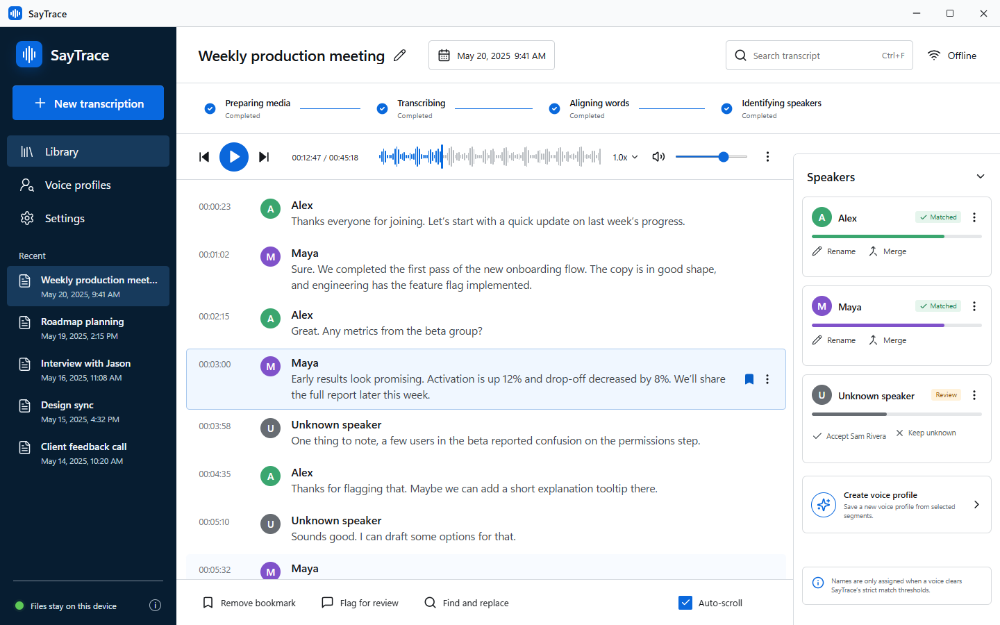
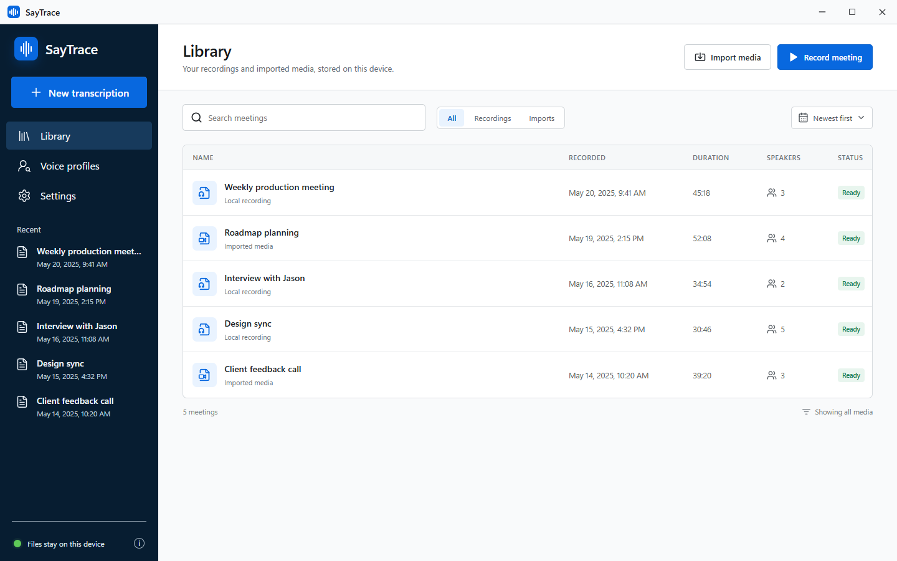

# SayTrace

SayTrace is a Windows-first desktop application for private meeting capture, audio/video transcription, and conservative speaker identification. Microphone and system audio are recorded locally as separate sources, live captions are treated as disposable drafts, and the canonical transcript is rebuilt from the saved media after recording stops. An explicit per-meeting option can also record the whole desktop, extract relevant screen moments beside the final transcript, and use visible meeting UI as reviewable speaker evidence.

The application does not use a cloud transcription service. Local AI stays on
the device. Network access is used during explicit model setup and, optionally,
when the user connects ChatGPT and permits cloud meeting questions.

## Screenshots

Speaker cards filter the transcript to one speaker. Settings includes versioned speaker backup/restore and automatic recovery snapshots. See [speaker filtering and recovery](docs/speaker-recovery.md) for the final short-segment checks and Windows recovery requirements.

The screenshots below use fabricated demo meetings, speakers, and transcript
text. They do not contain data from a personal SayTrace installation.

### Transcript workspace



### Local meeting library



## Architecture

- **React + TypeScript:** the desktop interface and ephemeral presentation state.
- **Tauri + Rust:** the trusted filesystem, SQLite, import/export, recording, encryption, and job boundary.
- **Python worker:** local live and final ML inference over private inherited pipes.

See [Architecture](docs/architecture.md), [Accuracy and privacy](docs/accuracy-and-privacy.md), and the [accepted design specification](docs/design-spec.md).

## Ask this transcript

Completed transcripts include an **Ask** panel for local question answering,
summaries, decisions, and action items. Answers are grounded in the saved
transcript and include timestamp citations that seek to the supporting turn.
Chat history and citations are stored in the same local SQLite library as the
meeting.

This feature uses an Ollama server on the fixed loopback endpoint
`http://127.0.0.1:11434`. The Windows setup verifies an existing compatible
Ollama installation or installs a pinned official per-user build. If no local
model exists, setup installs the pinned `qwen3:4b` starter model. Existing local
models are preserved. The Local AI provider lists only installed, non-cloud
models and does not send transcript text to a hosted model.

### Optional ChatGPT / Codex questions

In a completed meeting's **Ask** panel, choose **ChatGPT · Codex usage**, then
**Continue with ChatGPT**. Complete sign-in in your browser and enable **Allow
meeting text to be sent to OpenAI for these questions**. Select a model and ask
your question. This uses the connected account's available Codex plan usage or
credits, subject to account limits and model access; it does not require an API key.
The model catalog alone does not prove access to a model.

Install Codex for Windows to enable this optional provider. SayTrace runs its
app-server with a separate local authentication directory under its app data;
signing out here leaves the Codex desktop session alone. Codex manages its own
login credentials there; SayTrace does not expose tokens to the renderer.

Cloud questions send the question, selected transcript excerpts (including speaker
names), and recent meeting chat history to OpenAI. Audio, video, transcription,
and speaker processing remain local. Sharing permission resets on meeting or
provider changes; sign-in alone never sends meeting content. Answers retain
transcript timestamp citations, and cloud answers are labeled in local history.
There is no automatic fallback from local AI to cloud AI. Codex tools, shell,
web search, and external actions are disabled for meeting Q&A.

Integration reference: [OpenAI Codex App Server](https://learn.chatgpt.com/docs/app-server).

## Screen context

Screen recording is on by default, but recording cannot start until the user
separately acknowledges that the whole desktop across all connected displays,
notifications, and other visible applications may be saved. The review step also
provides a deliberate audio-only path. When enabled, SayTrace records a
low-frame-rate local screen track alongside the audio and pauses that track
whenever meeting capture is paused. After the final transcript is committed,
deterministic transcript cues select a bounded set of screen moments, which are
extracted as local JPEG assets and shown inline.

The optional visual-speaker pass uses only an installed, non-cloud Ollama vision
model. It looks for meeting-application evidence such as an active-speaker border
or visible participant label. A name must recur across distinct transcript turns
before it is proposed, and every proposal remains in **Review** until a person
confirms it. Voice-confirmed and manually assigned identities are never replaced.

## Development prerequisites

- Windows 11 x64
- Node.js 22 and npm
- Rust 1.88+ with the MSVC Windows target
- Python 3.13 managed through [uv](https://docs.astral.sh/uv/)
- FFmpeg and FFprobe for development imports

The normal production installer includes the locked Python worker, NVIDIA CUDA
runtime with CPU fallback, LGPL-compatible FFmpeg, and automatic WebView2
setup. Before copying SayTrace, setup verifies Windows, free storage, the
runtime manifest and entrypoints, the worker handshake, GPU capability, Ollama,
and a local agent model. The runtime copy then receives a full per-file SHA-256
pass. End users do not install Python, FFmpeg, a CUDA toolkit, WebView2, Ollama,
or a separate SayTrace runtime pack themselves. Setup does not replace display
drivers: unsupported or outdated GPU drivers use the verified CPU fallback.
Model files remain an explicit one-time first-run download because Community-1
requires the user to accept its terms.

## Start the interface

```powershell
npm ci
npm run dev
```

The browser preview uses the approved demonstration meeting so visual and interaction tests are deterministic. Packaged Tauri builds do not load demonstration meetings.

To run the desktop shell with local transcription, install the full worker extra
before launching Tauri. This is a multi-gigabyte local dependency set:

```powershell
uv sync --project worker --extra ml --group dev
npm run tauri:dev
```

## Worker development

The default worker environment contains only protocol and test dependencies; it does not download multi-gigabyte models.

```powershell
uv sync --project worker --group dev
uv run --project worker pytest worker/tests
uv run --project worker ruff check worker/src worker/tests
uv run --project worker mypy --config-file worker/pyproject.toml worker/src
```

Install the full local inference dependencies only on a supported ML build machine:

```powershell
uv sync --project worker --extra ml --group build
```

Model repositories, immutable revisions, required files, and file hashes are declared in `worker/model-manifest.json`. Community-1 is gated: first-run setup requires the user to accept its terms and provide a Hugging Face token. The token is discarded after setup.

## Verification

```powershell
npm test
npm run build
cargo fmt --manifest-path src-tauri/Cargo.toml --check
cargo test --manifest-path src-tauri/Cargo.toml
uv run --project worker pytest
```

The release gate also requires:

- a two-hour microphone/loopback synchronization soak;
- whole-desktop capture pause/resume, crash recovery, and long-recording playback;
- calibrated Teams and other supported-meeting-UI visual attribution testing;
- device removal, pause/resume, disk-full, and forced-termination recovery;
- blocked-network final transcription;
- calibrated speaker-name false-accept testing;
- clean Windows VM installation without system Python, CUDA, WebView2, or Ollama;
- screenshot comparison against both checked-in concepts.

## Privacy boundary

- Audio, screen video, extracted screenshots, transcripts, and model files stay in the local application-data library.
- Whole-desktop capture across all connected displays is enabled by default but separately disclosed and blocked behind an explicit pre-recording acknowledgement; users can choose audio-only recording and should hide sensitive windows and notifications before proceeding.
- Transcript questions are sent only to the local Ollama loopback endpoint; hosted Ollama models are excluded.
- Visual speaker frames are sent only to a compatible installed model through that same loopback endpoint and are never used for an automatic confirmed match.
- Voice embeddings are protected with Windows DPAPI for the current user.
- Audio and transcript files are not separately encrypted by the application; use BitLocker for whole-library at-rest encryption.
- The worker runs in explicit offline mode after model setup and has no listening network port.
- Weak or ambiguous speaker matches remain `Unknown`.

## License and attribution

SayTrace source code is licensed under the [Apache License 2.0](LICENSE).
You may use, modify, and redistribute it, including commercially, provided you
follow the license terms. Redistributions and derivative works must preserve
the attribution notices required by the license and the included [NOTICE](NOTICE)
crediting `acamporat`.

Model weights, FFmpeg, and third-party dependencies remain under their own
licenses and terms; see [Third-party notices](THIRD_PARTY_NOTICES.md). The
`SayTrace` name and branding are not granted for unrestricted trademark use by
the source-code license.

The internal application identifier, worker executable name, and data paths
retain their original `local-transcript` values for migration compatibility
with existing installations. They are implementation identifiers, not the
public product name.
